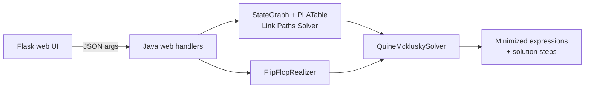

DigiLab
=======

## About
This Project offers a collection of tools that intend to ease the process of solving or dealing with certain problems in both  ***combinational/sequential logic design.***

## Installation
## First Method
1. ### Run the setup shell script using Git Bash  (PowerShell doesn't support it) or your native terminal if on a UNIX machine
    If it didn't work then try to append to the script file the executable flag ..(From Your Bash Terminal type this at the root directory of the repo)
    ```bash
    chmod +x setup.sh
    ```

## Second Method (Manual -- If you don't have the Bash terminal)

1. ### Install Flask MicroFrameWork for Python

    ```python
    pip3 install flask
    ```
2. ### Install MikTex for LaTex Support to Generate PDFs
    - ### Windows

        ```powershell
        winget install --id=MiKTeX.MiKTeX --source=winget
        ```
    
    - ### Linux

        ```bash
        sudo apt update
        sudo apt install -y miktex
        ```
        Then finish the setup
        ```bash
        miktexsetup finish
        initexmf --admin --set-config-value [MPM]AutoInstall=1
        ```
   
   - ### MacOS
        ```bash
        brew install  --cask miktex
        ```
        Then finish the setup
        ```bash
        miktexsetup finish
        initexmf --admin --set-config-value [MPM]AutoInstall=1
        ```


## Tools Included

> ### _Quine Mcklusky Solver_
 Helps you to get the optimal expression of a function given it's defining  min-terms and dont-cares

> ### _Link Paths Solver_
 Helps you solve a sequential system (Finite State Machines) in an SM chart way given it's defining link paths from one state to another, and the Moore Outputs linked to every state
 > ### _Flip-Flop Realizer_
 Helps you realize a boolean expression given the state-variable name and input-variable names and the flip-flop type.
 > ### _Flip-Flop Config Adder_
 Considered a helping tool to the FFRealizer and it's main purpose is to help you add a custom Flip-Flop configuration for you to use later in Realization.
DigiLab
=======

## About
This Project offers a collection of tools that intend to ease the process of solving or dealing with certain problems in both  ***combinational/sequential logic design.***

## Installation
## First Method
1. ### Run the setup shell script using Git Bash  (PowerShell doesn't support it) or your native terminal if on a UNIX machine
    If it didn't work then try to append to the script file the executable flag ..(From Your Bash Terminal type this at the root directory of the repo)
    ```bash
    chmod +x setup.sh
    ```

## Second Method (Manual -- If you don't have the Bash terminal)

1. ### Install Flask MicroFrameWork for Python

    ```python
    pip3 install flask
    ```
2. ### Install MikTex for LaTex Support to Generate PDFs
    - ### Windows

        ```powershell
        winget install --id=MiKTeX.MiKTeX --source=winget
        ```
    
    - ### Linux

        ```bash
        sudo apt update
        sudo apt install -y miktex
        ```
        Then finish the setup
        ```bash
        miktexsetup finish
        initexmf --admin --set-config-value [MPM]AutoInstall=1
        ```
   
   - ### MacOS
        ```bash
        brew install  --cask miktex
        ```
        Then finish the setup
        ```bash
        miktexsetup finish
        initexmf --admin --set-config-value [MPM]AutoInstall=1
        ```


## Tools Included

> ### _Quine Mcklusky Solver_
 Helps you to get the optimal expression of a function given it's defining  min-terms and dont-cares

> ### _Link Paths Solver_
 Helps you solve a sequential system (Finite State Machines) in an SM chart way given it's defining link paths from one state to another, and the Moore Outputs linked to every state
 > ### _Flip-Flop Realizer_
 Helps you realize a boolean expression given the state-variable name and input-variable names and the flip-flop type.
 > ### _Flip-Flop Config Adder_
 Considered a helping tool to the FFRealizer and it's main purpose is to help you add a custom Flip-Flop configuration for you to use later in Realization.

---

# How It Works

This section explains the algorithms behind the tools: what each core class does, how data flows between them, and where the known limits are. Web handlers (the JSON glue code) are intentionally left out.

## Architecture

The Flask front end (`web/app.py`) starts the Java core as a subprocess for every request. Input goes in as a JSON command-line argument and the result comes back as JSON on stdout. The Link Paths tool also generates a TikZ state diagram and compiles it to PDF with `pdflatex`.



Everything reduces to one primitive: **minimizing a boolean function given its ON-set and don't-care set**. `QuineMckluskySolver` does that. The other two tools are translators that build those sets from a state diagram or from a next-state expression.

## Core Representation: Terms

A boolean term (a "cube") is a string over `{0, 1, -}`:

| Character | Meaning |
|-----------|---------|
| `1` / `0` | Variable appears uncomplemented / complemented |
| `-`       | Variable is absent (don't care) |

Example: over variables `(Q, A, B)`, the term `1-0` means `Q·B'`.

- **Ordering:** state bits come first (most significant first), followed by the input variables.
- **Coverage:** term X *covers* term Y if every non-dash bit of X equals the corresponding bit of Y. `-0-` covers `10-`, but not the other way around.
- **Variable notation (expressions):** `A`, `A'`, multi-character names in parentheses `(Ab)`, negated as `(Ab)'`. Single letters can be written without parentheses; any longer name, including the state variable, needs them.

## Quine–McCluskey Solver

### Main classes

| Class | Role |
|-------|------|
| `Term` | One cube: its bits, count of ones, `isChecked` (already merged), `isDontCare`. Also holds the cube algebra: coverage tests, intersection and complement |
| `Group` | Terms that share the same number of ones |
| `iteration` | One pass of the algorithm: an array of `Group`s indexed by number of ones |
| `SimplificationData` | Every iteration plus the final prime implicants, so the UI can show the steps |
| `OptimizationGrid` | The prime-implicant (PI) chart and the cover-selection logic |
| `OptimizationResult` | The chosen terms plus the PI chart |

### Phase 1: find the prime implicants

1. Place every ON term and every don't-care term into groups by number of ones. Don't-cares are flagged `isDontCare`.
2. Merge terms that differ in exactly one bit into a new term with `-` in that position, and mark both parents as checked.
3. The merged term is a don't-care **only if both parents were**. A don't-care merged with a real term becomes real, which is how don't-cares enlarge the groupings without ever having to be covered.
4. Carry unchecked terms forward unchanged into the next iteration.
5. Stop when an iteration performs no merges. Everything left is a prime implicant, except terms that are purely don't-care.

The solver has two merge strategies:

| Variant | Compares | Use |
|---------|----------|-----|
| `getPrimeImplicantsMinTerms` (classic) | Adjacent groups only (ones-count differs by exactly 1) | Plain minterm input |
| `getPrimeImplicantsMixedTerms` | Each term against every group with an equal or higher count | Input that already contains `-` (what the other tools produce) |

The mixed variant exists because adjacency by ones-count stops being reliable once terms contain dashes. It applies three rules to a pair of terms:

1. **Differ in exactly one bit:** a regular merge.
2. **One term fully covers the other:** the covered term is marked checked (absorbed) and nothing new is added.
3. **The broader term implicitly contains a minterm one bit away from the narrower term** (`ContainsTermToOptimize`): the narrower term is rewritten with that bit dashed. For example, `--10` implicitly contains `0110`, which is one bit from `0111`, so `0111` becomes `011-`.

### Phase 2: choose a cover

`OptimizationGrid` builds a boolean chart of which PI covers which ON term. Only ON terms need covering; don't-cares never do. A term counts as covered only if one PI fully contains it. Two counters drive the selection:

- `minTermsCoverCount`: how many PIs still cover each ON term
- `coveringTermsCount`: how many still-uncovered ON terms each PI covers

Selection runs in two steps:

1. **Essential PIs.** While some ON term is covered by exactly one PI, pick that PI.
2. **Greedy completion.** Repeatedly pick the PI that covers the most uncovered ON terms, breaking ties toward fewer literals, until everything is covered.

Marking a PI as picked sets the covered terms' counters to a large sentinel (`10000`) so they never look "important" again, and decrements the counters of the other PIs that covered them. If any ON term has no covering PI, the function returns `null`.

### Output

`GetExpression` turns the chosen cubes into a sum of products: `1` becomes the variable, `0` becomes the variable with a prime, `-` is skipped, and an all-dash cube yields the constant `1`. Passing `null` for the variable names returns the raw cube strings.

### Guarantees and limits

- **Correct, but not guaranteed minimal.** Every chosen PI is a valid implicant, so the result is a valid expression. Essential PIs are the same first reduction that Petrick's method makes. The greedy step afterwards is a heuristic, and it can pick a larger cover than the true minimum.
- **Example:** `f = Σm(0,1,2,5,6,7)` over `A,B,C` has six prime implicants (`A'B'`, `A'C'`, `B'C`, `BC'`, `AC`, `AB`), each ON term is covered by exactly two PIs, and there are no essentials. The minimum cover has 3 terms (for example `A'B' + BC' + AC`), but depending on tie-breaking the greedy step can end with 4.
- **Cube-level coverage.** A cover is accepted only if each ON cube lies entirely inside a single chosen PI. This is stricter than minterm-level coverage and can rule out cheaper covers.
- **Cost.** The number of PIs can grow exponentially with the number of variables, as with any Quine–McCluskey implementation.

## Link Paths Solver (`StateGraph` + `PLATable`)

This tool turns a state diagram into minimized logic equations for the next-state bits and the outputs.

### Model

- `State`: an ID, a Moore output string, and its **outgoing** `Link`s only.
- `Link`: source state, target state, an input pattern and a Mealy output pattern. Patterns are strings aligned with the variable lists, so `10-` over `(A, B, C)` means `A·B'`.
- `StateGraph`: the set of states plus the input and output variable names.
- `PLATable`: a list of `RelationRow(currentState, nextState, input, output)`, which is the programmable-logic-array style table used for solving.

### Algorithm

1. **Build the graph** from the link paths and Moore outputs.
2. **`ToPLATable(mooreOutputs, stateBitCount)`:**
   - Every link becomes one row.
   - There are `2^stateBitCount` possible state codes. Every code that has no outgoing row gets a row whose next state, inputs and outputs are all don't-cares (a state with no outgoing links keeps its Moore output). These free don't-cares let the minimizer shrink the equations further.
   - `stateBitCount` must be large enough for the largest state ID.
3. **State encoding.** The code for a state defaults to its ID in binary. A `stateAssignments` array can replace it (see below).
4. **Term extraction for one target bit** (`GetTermsOf` / `GetDontCaresOf`). Each term is `stateCode + inputPattern`:
   - *Next-state bit i:* ON for every row whose next-state code has a `1` at bit i, don't-care where it has `-`.
   - *Output bit j:* ON for every row whose Mealy output has `1` at bit j, plus a term `stateCode + ----` for every row whose current state's Moore output has `1` there. Don't-cares work the same way with `-`.
5. **Solve each bit** (`SolveVariableAt`): run the mixed-term prime implicant search, then the cover selection. Bit 0 of the state variables is the most significant state bit.
6. **Diagram.** `ToLaTexCircularGraph` places the states on a circle by rotating a starting point, and emits TikZ with loop edges for self-transitions and bent edges for the rest.

The state-bit equations are the next-state functions (what a D flip-flop needs). To use other flip-flop types, feed such an equation into the Flip-Flop Realizer.

### `stateAssignments`

An optional array mapping each state ID to a binary code, for example `stateAssignments[3] = "10"`. The code you choose changes which minterms are adjacent, so it changes the minimized equations. A Gray code `{"00","01","11","10"}` and plain binary can give different results.

It is valid only if it is non-null, has at least `2^n` entries (n = state bits), and its first `2^n` entries are non-null strings over `{0,1,-}` of length exactly n. An invalid array silently falls back to the default binary encoding. Entries for unused state IDs also matter: those IDs become don't-care rows, so fill them with the codes that are actually unused. The web app does not pass a custom assignment yet (optimal assignment is a TODO).

### Moore and Mealy outputs together

For each output bit, a `1` from either source (the link's Mealy output or the state's Moore output) makes the output `1`. A `-` from either source frees the minimizer to choose a value there. Use `0` when you mean "definitely off".

### Worked example

One input `X`, one output `Z`, one state bit `Q`. Transitions (input / Mealy output):

| From | To | Input X | Output Z |
|------|----|---------|----------|
| S0 | S1 | 1 | 0 |
| S0 | S0 | 0 | 0 |
| S1 | S0 | 1 | 1 |
| S1 | S1 | 0 | 0 |

Moore outputs are `0` for both states. Terms are written `Q X`:

- Next-state bit: ON terms `01` (S0 to S1 on X=1) and `10` (S1 to S1 on X=0). They differ in two bits, so neither merges, giving `Q⁺ = Q'X + QX'`.
- Output Z: the only row with output `1` is S1 on X=1, giving ON term `11`, so `Z = QX`.

## Flip-Flop Realizer

Given the next-state function of one state variable as an expression, and a flip-flop type, it finds the minimized equation of each control line (S and R, J and K, T, and so on).

### Excitation tables as configuration

`ControlLineRuleSet` holds a name and a 2×2 grid `ruleGrid[current][next]` with entries `0`, `1` or `-`. This grid is the excitation table of one control line: the value that line must take to move the flip-flop from `current` to `next`. An `FFRuleSet` is a list of these lines.

For example, an SR flip-flop is:

| Line | 0→0 | 0→1 | 1→0 | 1→1 |
|------|-----|-----|-----|-----|
| S | 0 | 1 | 0 | - |
| R | - | 0 | 1 | 0 |

Because flip-flop types are just data, any flip-flop can be added through the Flip-Flop Config Adder.

### Algorithm

1. **Parse each product term** (`GetRowInString`) into `stateBit + inputBits` with `-` for variables the term doesn't mention. Multi-character variable names must be in parentheses, and the state variable must not appear in the input-variable list.
2. **Build the transition table** (`GetTableFromExpression`). It must cover every (state, input) combination, because some control lines depend on where the next state is `0`:
   - Each ON term becomes rows with next state `1`: `0→1` if its state bit is `0`, `1→1` if it is `1`, both if it is `-`.
   - The OFF set (where the function is `0`) is computed by De Morgan's law: the complement of a sum of products is the product of the complements. It starts as the all-dash term and is intersected with the complement of each ON term.
   - OFF cubes become rows with next state `0`. Rows identical to existing ones are skipped.
3. **Solve each control line** (`SolveControlLineAt`). For every table row, read `ruleGrid[currentState][nextState]`:
   - `1`: add `stateBit + input` to the line's ON terms
   - `-`: add it to the line's don't-cares
   - `0`: skip it

   Then run the mixed prime implicant search and the cover selection. If a line has no ON terms it is the constant `0`.

### Why the OFF set is needed

The expression only says where `Q⁺ = 1`, but control lines also depend on transitions to `0`. For an SR flip-flop, R must be `1` on every 1→0 transition, and 0→0 is a don't-care for R. Without the OFF rows:

- R would have no ON terms and would come out as the constant `0`, which is wrong (with Q=1 and A=0 the flip-flop must be reset).
- The 0→0 rows would be missing, and those are the don't-cares that let the minimizer merge terms into compact ones like `-0-`.

### How the OFF set is computed (`Term.getComplement`)

The complement is built with cube operations instead of a truth table. The code lives in `QuineMckluskySolver.java` (class `Term`) and is called from `GetTableFromExpression` in `FlipFlopRealizer.java`.

- **`Term.getComplement()`** returns the complement of one cube as a list of single-literal cubes. Each specified bit produces one cube with that bit flipped and every other position set to `-`. A `-` bit produces nothing. This is De Morgan's law: the complement of a product is a sum of complemented literals. For example, `111` becomes `0--`, `-0-` and `--0`, and `10-` becomes `0--` and `-1-` (that is, `(A·B')' = A' + B`).
- **`Term.getIntersection(a, b)`** ANDs two cubes bit by bit. It returns `null` when one cube has `0` and the other has `1` in the same position, since the intersection is empty.
- **`Term.getIntersectionList(listA, listB)`** intersects every pair, skips duplicates, and drops existing cubes that a newer cube covers.

`GetTableFromExpression` starts with the all-dash cube (the whole space) and, for each ON term, intersects the running list with that term's complement. The complement of a sum of products is the product of the complements, so after the last ON term the list is exactly the zero region of the function, as a small set of cubes. Each OFF cube then becomes a row with next state `0`.

A truth-table approach would need `2^(n+1)` rows for `n` input variables and would lose the compact cube form that the mixed-term minimizer is designed to work with.

### Worked example

Function `Q⁺ = Q·A·B + Q'·A·B'` on an SR flip-flop. The OFF cubes come out as `1-0`, `-0-`, `10-`, `0-1`, `00-`, and the resulting table has six rows:

| Current → next | Input (A B) |
|----------------|-------------|
| S1 → S1 | 11 |
| S0 → S1 | 10 |
| S1 → S0 | -0 |
| S0 → S0 | 0- |
| S1 → S0 | 0- |
| S0 → S0 | -1 |

- **S:** ON term `010` (the S0→S1 row), don't-care `111` (the S1→S1 row). They don't merge, so `S = Q'AB'`.
- **R:** ON terms `1-0` and `10-` (the S1→S0 rows), don't-cares `00-` and `0-1` (the S0→S0 rows). `10-` and `00-` merge into `-0-`, and `1-0` stays. Each ON term is covered by exactly one PI, so both are essential: `R = A' + QB'`.

Check: with Q=1, A=1, B=0 we get R=1, so the next state is 0, which matches the function.

### Limits

- One state variable only. Any further state bits must be passed as ordinary input variables.
- Each control line is minimized independently, with no shared terms across lines.

## Known Limitations and Future Work

- Replace the greedy cover step with Petrick's method (or a branch-and-bound exact cover) so results are provably minimal.
- Implement optimal state assignment so the Link Paths Solver can choose a good `stateAssignments` automatically.
- Share terms across the equations of a multi-output system.
- Represent cubes as bit masks (value and mask integers) instead of strings for faster comparison and merging.
- Cross-check the solver against brute-force truth tables on random functions.
